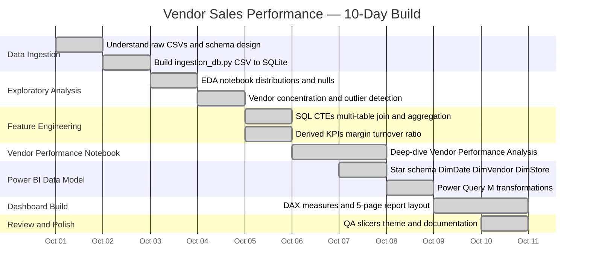

> An end-to-end data analytics project that uncovers procurement inefficiencies, vendor concentration risks, and profitability drivers across 12.8M+ sales transactions and 2.37M+ purchase records.

---

## 📌 Project Overview

This project delivers a **full-stack analytics pipeline** for evaluating vendor and sales performance in a retail/wholesale inventory business. The goal is to help procurement and operations teams make data-driven decisions by surfacing:

- Which vendors drive the most revenue and profit
- Where procurement is overly concentrated (top 10 vendors = **65.69% of purchasing**)
- How inventory is turning across stores and products
- Freight cost efficiency and payment behaviour per vendor

The pipeline flows from **raw CSVs → SQLite database → Python-engineered features → Power BI executive dashboard**.

REFER TO THE DASHBOARD - 

---

## 🗂️ Project Structure

```
Vendors-Sales-Performance/
│
├── notebooks/
│   ├── EDA.ipynb                         # Exploratory Data Analysis
│   └── Vendor Performance Analysis.ipynb # Deep-dive vendor profiling
│
├── scripts/
│   ├── ingestion_db.py                   # Loads CSVs into SQLite database
│   └── get_vendor_summary.py             # SQL joins + feature engineering
│
├── powerbi/
│   ├── measures.dax                      # All DAX measures for Power BI
│   ├── power_query_templates.md          # Power Query M transformation guide
│   ├── dashboard_layout.md               # 5-page dashboard layout spec
│   ├── theme.json                        # Custom Power BI theme
│   └── README.md                         # Power BI build instructions
│
└── README.md
```

---

## 🧰 Tech Stack

| Layer | Tool / Technology |
|---|---|
| **Language** | Python 3.x |
| **Data Storage** | SQLite (via `inventory.db`) |
| **ORM / DB Engine** | SQLAlchemy |
| **Data Manipulation** | Pandas |
| **Query Language** | SQL (CTEs, multi-table joins) |
| **Notebooks** | Jupyter Notebook |
| **Visualization / BI** | Microsoft Power BI Desktop |
| **DAX Measures** | DAX (Data Analysis Expressions) |
| **ETL / Transform** | Power Query (M language) |
| **Version Control** | Git & GitHub |
| **Logging** | Python `logging` module |

---
## ⏱️ Build Timeline — 10 Days




---

## ⚙️ How It Works

### 1. Data Ingestion
`scripts/ingestion_db.py` scans the `data/` folder, loads every CSV into a **SQLite database** (`inventory.db`), and logs timing and status to `logs/ingestion_db.log`.

### 2. Feature Engineering
`scripts/get_vendor_summary.py` runs a multi-CTE SQL query across 4 tables (`purchases`, `purchase_prices`, `sales`, `vendor_invoice`) and computes engineered KPIs:

| Feature | Formula |
|---|---|
| Gross Profit | `Total Sales − Total Purchase Dollars` |
| Profit Margin | `Gross Profit / Total Sales × 100` |
| Stock Turnover | `Total Sales Quantity / Total Purchase Quantity` |
| Sales-Purchase Ratio | `Total Sales / Total Purchase Dollars` |

### 3. Exploratory Data Analysis
Jupyter notebooks (`EDA.ipynb`, `Vendor Performance Analysis.ipynb`) profile the data, validate distributions, and surface vendor concentration insights before dashboard build.

### 4. Power BI Dashboard (5 Pages)

| Page | Focus |
|---|---|
| Executive Overview | KPI cards, Gross Profit Waterfall, Top 10 Vendors |
| Vendor Performance | Scatter matrix, Pareto chart, conditional formatting |
| Product & Sales | Monthly trends, Decomposition tree, Top/Bottom products |
| Inventory | Sell-through proxy, Slow-movers, Store-level inventory |
| Procurement & Invoices | Freight rate, Payment days, PO-level breakdown |

---

## 📊 Key Metrics (DAX)

```dax
Gross Profit Proxy     = [Net Sales] - [Purchase Spend] - [Freight Cost] - [Excise Tax]
Profit Margin Proxy    = DIVIDE([Gross Profit Proxy], [Net Sales])
Stock Turnover Proxy   = DIVIDE([Sales Units], [Purchase Units])
Freight Rate           = DIVIDE([Freight Cost], SUM(vendor_invoice[Dollars]))
Average Payment Days   = AVERAGEX(vendor_invoice, DATEDIFF(InvoiceDate, PayDate, DAY))
Top 10 Vendor Share    = 65.69% of total purchasing
```


## 🚀 Getting Started

### Prerequisites

```bash
pip install pandas sqlalchemy jupyter
```

### Run Ingestion

```bash
cd scripts
python ingestion_db.py
```

### Build Vendor Summary Table

```bash
python get_vendor_summary.py
```

### Open Notebooks

```bash
cd notebooks
jupyter notebook
```

### Power BI

Open Power BI Desktop, point the `DataFolder` parameter to your `data/` directory, then follow the instructions in [`powerbi/README.md`](powerbi/README.md).

---

## 💡 Key Insights

- 🏆 **Top 10 vendors account for 65.69% of all purchasing** — high procurement concentration risk
- 📉 Some vendors show **negative gross profit proxy** — flagged with conditional formatting in the dashboard
- 🔄 **Stock Turnover < 1** on certain brands indicates slow-moving inventory
- 🚚 **Freight rate analysis** reveals vendors with abnormally high freight-to-spend ratios

---
## 👩‍💻 OVERVIEW 
# 🛒 Vendor Sales Performance Analysis


---
## 👩‍💻 Author

**Samruddhi Ganu**  
· October 2026

---

> ⚠️ *Gross Profit Proxy and Stock Turnover Proxy are management estimates based on purchase spend, not accounting COGS. These are operational proxies, not audited financials.*
